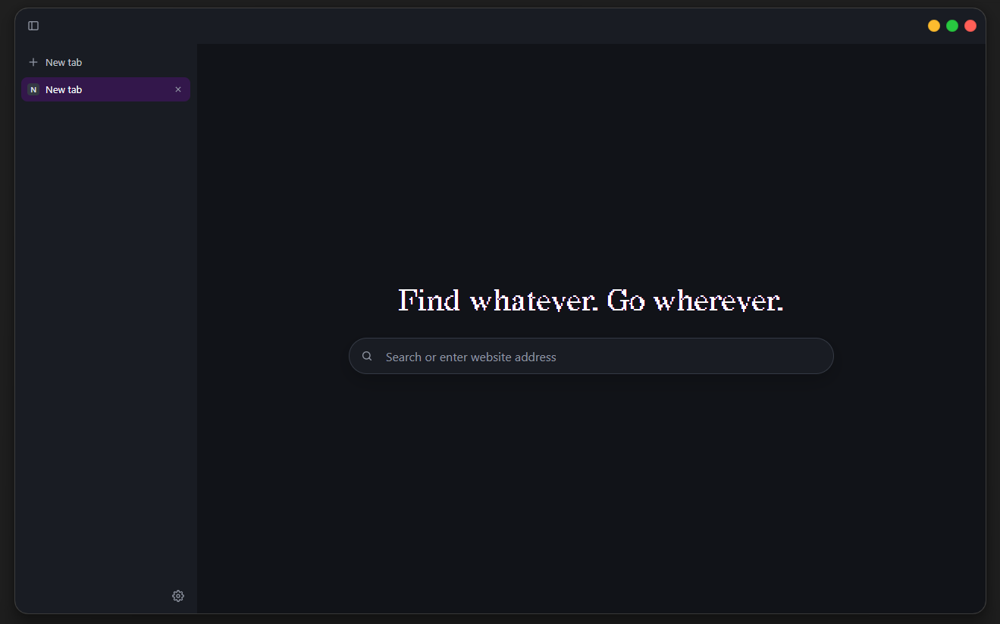
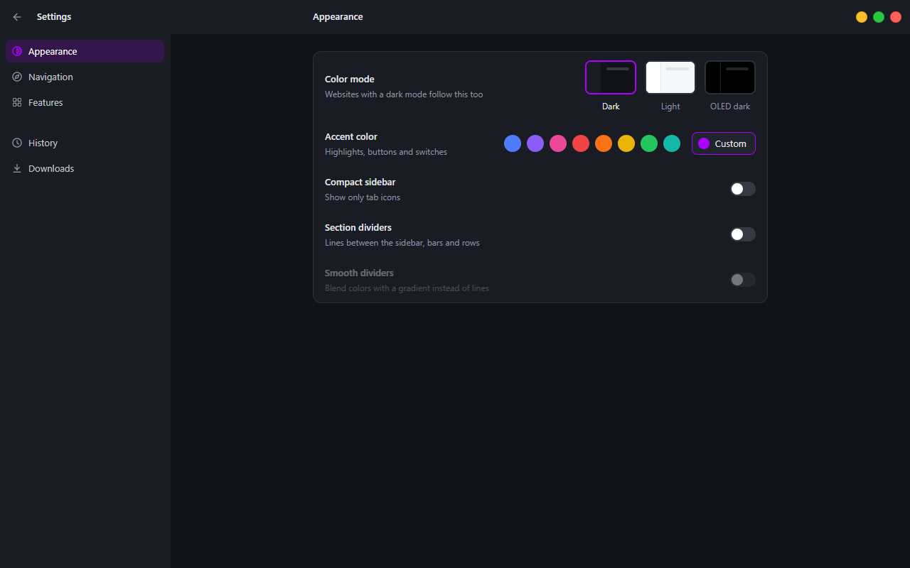

<p align="center">
  
</p>

<h1 align="center">Nya</h1>

<p align="center">
  A clean, minimal web browser with vertical tabs.
</p>

<p align="center">
  <a href="https://github.com/ttttima/Browser/releases"></a>
  
  <a href="LICENSE"></a>
</p>

<p align="center">
  
</p>

## Install

**Recommended:** open **PowerShell** and paste this line:

```powershell
irm https://raw.githubusercontent.com/ttttima/Browser/main/install.ps1 | iex
```

It downloads the newest Nya, installs it just for you (no administrator
rights), adds Start menu and desktop shortcuts, and starts it.

**Or download it** from the [Releases](https://github.com/ttttima/Browser/releases)
page:

- `Nya-x.y.z-Setup.exe`: installer
- `Nya-x.y.z-portable.zip`: no install, unzip and run `Nya.exe`

Nya isn't code-signed yet, so Windows may say _"Windows protected your PC"_
for downloaded files. Click **More info → Run anyway**. The PowerShell line
above doesn't trigger this.

## Update

Nya doesn't update by itself yet. Update the same way you installed it:

- **PowerShell line:** paste the same line again. It closes Nya, puts the
  newest version in place and starts it.

  ```powershell
  irm https://raw.githubusercontent.com/ttttima/Browser/main/install.ps1 | iex
  ```

- **Setup.exe:** download the newest `Nya-x.y.z-Setup.exe` from
  [Releases](https://github.com/ttttima/Browser/releases) and run it. It
  replaces the old version.
- **Portable zip:** download the newest zip, close Nya and unzip it over the
  old folder.

Your settings, history and downloads list are kept: they live in
`%APPDATA%\Nya`, not in the app folder.

## Features

- **Vertical tabs** in a sidebar, with a compact icons-only mode and
  scrolling through tabs with the mouse wheel
- **Clean new tab page**: just a search bar, nothing else
- **Quiet address bar**: shows only the site name until you click it
- **Picks up where you left off**: your tabs come back after a restart,
  with pinned tabs, muting and private tabs (Ctrl+Shift+N)
- **Smart address bar**: suggestions from your history, bookmarks and open
  tabs as you type, and a lock that shows whether a site is secure
- **Bookmarks**: the star in the address bar or Ctrl+D, and import from
  Chrome, Edge, Brave, Opera, Vivaldi or Firefox
- **Passwords**: saved encrypted on your computer and filled in when you
  sign in; import them from a CSV
- **History and Downloads** pages: search, reopen and remove visits; pause,
  resume, open and retry downloads
- **Everyday tools**: find on page, print, save page, right-click menus,
  spell check, PDF viewer, open files or drop them on the window
- **Ad and tracker blocking**, which you can turn off for a single site
- **Sites ask first** before using your camera, microphone, location,
  notifications or screen
- **Updates itself** from the GitHub releases when a new version is out
- **Color modes**: dark, light and OLED (pure black), with any accent color
- **Force dark mode**: makes every website dark, without flashing
- **Protected video and music** (DRM) through Google's Widevine, which
  downloads by itself on first launch
- **Can be your default browser**: Settings → Navigation → Make default
- **Smooth dividers**: soft gradients between areas instead of hard lines
- **Window animations**: Nya rises into place in 3D with a glow of your
  accent color when it opens, and tips back and falls away when it closes
- **Your own shortcuts**: bind any action to a key or mouse button, and add
  shortcuts that open your favorite sites
- **Everything stays on your computer**: history, bookmarks, passwords and
  settings are never sent anywhere
- **No admin rights**: installs and runs just for your user

<p align="center">
  
</p>

## Uninstall

Open Windows **Settings → Apps → Installed apps**, find **Nya** and choose
**Uninstall**. Your settings and history stay in `%APPDATA%\Nya`; delete that
folder too if you want them gone.

## Build from source

You need [Node.js](https://nodejs.org).

```bash
npm install
npm start          # run in development
npm run make       # build the installer and zip into out/make
```

Nya uses [castLabs Electron](https://github.com/castlabs/electron-releases),
which adds Widevine. Netflix and a few other services also need the app to be
VMP-signed. The build does that automatically when castLabs' free signing
tool is set up:

```bash
pip install castlabs-evs
python -m castlabs_evs.account signup
```

## License

[MIT](LICENSE)
